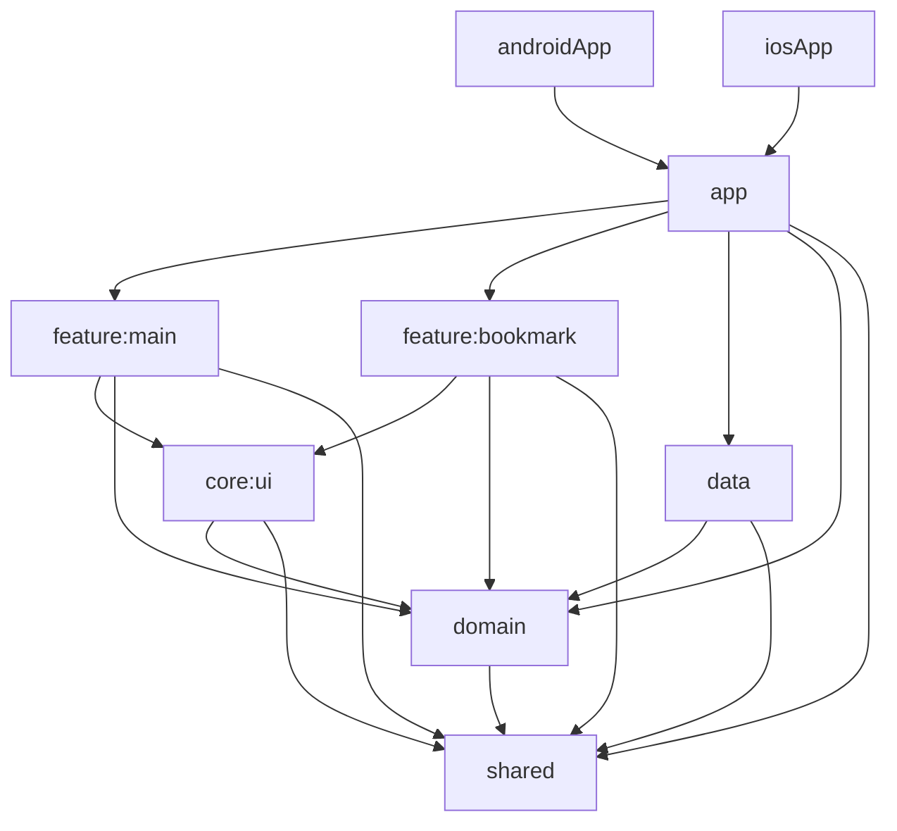

# compose-multiplatform-architecture
Project to support multiple platforms with one code.
The existing architecture repository and compose respositories have been deleted.
It has been integrated into this repository instead.

## Architecture

### Multiplatform
Each modules can uses platform-specific API.

The Platform-specific APIs used are integrated into a common Kotlin API.


### Clean Architecture

UI can only be changed through references to UiState.

To deliver user interaction results, only access is allowed through Presenter.

Repository contracts and the `CharacterItem` model belong to `domain`.
The `data` module implements those contracts and maps SQLDelight database rows
to domain models before returning them. Domain use cases do not depend on `data`.

Module dependencies:

- `androidApp` packages the Android application and depends on `app`.
- `app` is the composition root: it hosts the shared navigation graph, platform
  entry points, and DI wiring between domain contracts and data implementations.
- `feature:main` owns the character list screen, its MVI presentation logic,
  ViewModel bindings, and main destination.
- `feature:bookmark` owns the bookmark screen, its MVVM presentation logic,
  and bookmark destination.
- `core:ui` contains shared Compose components, themes, resources, and UI flow
  collection extensions.
- Features depend on `core:ui`, `domain`, and `shared`. They do not depend on
  `app`, `data`, or other features.
- `data` depends on `domain` and `shared`.
- `domain` depends on `shared`, coroutines, and Paging.
- `shared` contains platform utilities and common infrastructure.



### Screen modules and navigation

Screen code lives under `feature/<screen>/src/commonMain`, with platform-specific
presentation behavior in `androidMain` or `iosMain` when needed. Reusable visual
components and resources live in `core/ui`, keeping features independent.

`App.kt` combines the typed `MainDestination` and `BookmarkDestination` routes
using Compose Multiplatform Navigation. Each feature exposes a `NavGraphBuilder`
extension and receives navigation callbacks. Only `app` decides which feature
to open; screens do not start activities or push native view controllers.
Both platforms share the same back stack, including the bookmark back button.
See the [Compose Multiplatform Navigation documentation](https://kotlinlang.org/docs/multiplatform/compose-navigation.html).

ViewModels use the multiplatform AndroidX lifecycle implementation and are owned
by their navigation back stack entries. The main ViewModel stays alive while
bookmarks are open; popping a destination clears that destination's ViewModel.
The app's `AppViewModelFactory` creates a fresh screen-scoped DI component when
a destination first requests its ViewModel. Mutable presentation state and event
dispatchers use `ViewModelScope`; shared infrastructure stays in the application
component.

To add a screen, create a KMP module under `feature`, expose its typed destination
and graph extension, add a ViewModel factory to the app composition root, and
register the destination in `App.kt`.

`com.example.data.database.Character`, `PagingKey`, and `LocalDatabase` are
generated from `data/src/commonMain/sqldelight` during the Gradle build.
Do not add handwritten classes with those names.


### Compose Multiplatform + MVI

When events and effects occur due to user interaction, they are delivered to the processor.

Processor processes business logic and updates changed UI state.

UI state is updated according to the Compose life cycle.

The operation of Event and Effect is as shown below :


#### Event

First-input, first-output structure ensures input/output order.


#### Effect

As an asynchronous task, it is output in the order in which the task is completed.


#### Event + Effect

Concurrency and sequential task possible using Event and Effect.


### Compose Muliplatform + MVVM
It is necessary to create a view model that matches the view life cycle of each platform, Android and iOS.

UI updates should also be tailored to each platform's UI lifecycle.

Other than that, it is the same as the general MVVM pattern.


## Libraries
Many previously used libraries do not yet support multiplatform.

If necessary, you need to change to a compatible library. 

The libraries used in this project are as follows.

- Database - [SqlDelight](https://github.com/cashapp/sqldelight)

- Network - [Ktor](https://github.com/ktorio/ktor)

- Image - [Coil3](https://github.com/coil-kt/coil)

- Design - [Meterial3](https://android.googlesource.com/platform/frameworks/support/+/refs/heads/androidx-main/compose/material3/)

- DI - [kotlin-inject](https://github.com/evant/kotlin-inject)

- Paging - [AndroidX Paging](https://developer.android.com/jetpack/androidx/releases/paging)

- Navigation - [Compose Multiplatform Navigation](https://kotlinlang.org/docs/multiplatform/compose-navigation.html)

- Logger - [Napier](https://github.com/AAkira/Napier)

- Build flavor - [BuildKonfig](https://github.com/yshrsmz/BuildKonfig)

- Datetime - [kotlin-datetime](https://github.com/Kotlin/kotlinx-datetime)

- Permission - [accompanist](https://github.com/google/accompanist)

- Crypto - [kotlincrypto](https://github.com/KotlinCrypto/core)

- Number - [ionspin](https://github.com/ionspin/kotlin-multiplatform-bignum)

## Building

Use JDK 17 or newer and install Android SDK Platform 37.1. Gradle downloads the
project's pinned build tools and dependencies through the wrapper.

Set `sdk.dir` in the ignored `local.properties` file if the SDK is not discovered
automatically. To load real Marvel data, also set `API_PUBLIC_KEY` and
`API_PRIVATE_KEY` there (or as environment variables). Missing API keys do not
prevent compilation.

```shell
./gradlew :androidApp:assembleDebug :domain:testAndroidHostTest :data:testAndroidHostTest :feature:bookmark:testAndroidHostTest
```

On Windows, use `gradlew.bat`. Run the `androidApp` module in Android Studio.
The `app` module remains the Compose Multiplatform entry library used by Android
and the existing Xcode project; screen implementations live in `feature` modules.
iOS builds require macOS and Xcode, with ARM64 device
and Apple Silicon simulator targets; current dependencies no longer support the
Intel iOS simulator target.
